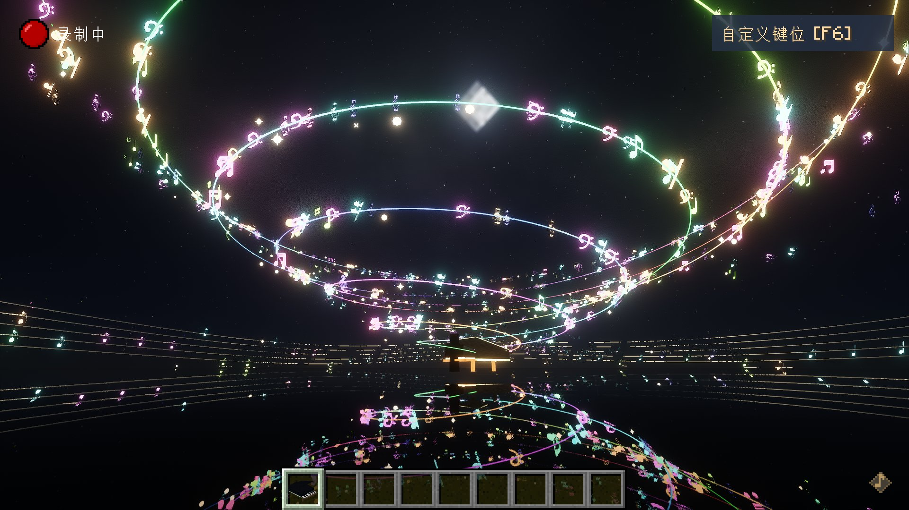
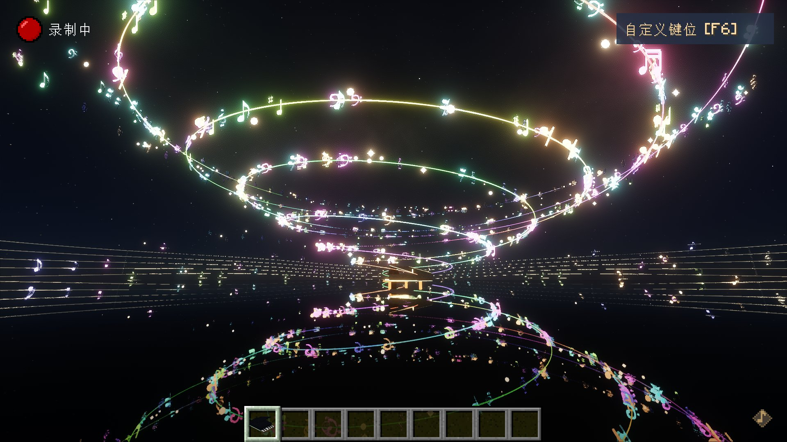

# MC 彩虹钢琴 · MC Rainbow Piano

> Minecraft Fabric 1.21.1 钢琴可视化模组 —— 把 MIDI 演奏变成漫天彩虹音符与光带。

[](https://www.minecraft.net/)
[](https://fabricmc.net/)
[](LICENSE)

> ⚠️ **兼容性：目前仅适配 Minecraft 1.21.1 + Fabric**（需要 Fabric API）。
> 其他 MC 版本（1.20.x / 1.21.2+ / Forge / NeoForge）**暂不支持**，装上去会直接报错。

**⬇️ 下载：[v0.1.0 Release](https://github.com/Endlessliujiale/MC-Rainbow-Piano/releases/latest)** —— `pianofx-0.1.0-extended-piano.jar`




---

## 这是什么

放一架三角钢琴，导入一份 MIDI 谱子，按下播放：

- **三条螺旋**从琴口升起，绕着钢琴盘旋而上；
- 每条螺旋都是一条**彩虹光带**：源头持续生长、远端一节节破碎消失，永远在流动；
- **每个音符**是一颗发光字形（♪ ♫ ♩ 𝄞 𝄢 按音高换形），沿着光带飞出去；
- 飞远的音符**平滑下降**，在比螺旋更远的地方聚成**行星轨道**，绕圈、放大、慢慢消散；
- 曲子结束，光带从最远端碎回琴口，音符渐变破碎 —— 不是"啪"地消失，是一点点化掉。

颜色按音高取（12 个音高 12 个色相），同一颗键永远同一种颜色。

---

## 我开源它，是为了这件事

这套东西还有一半没做完。**我想看到的方向是：每按下一个键，都长出属于它自己的那条音轨 —— 方向、弯曲、颜色都不一样。**

现在所有音符走的是同一组螺旋、只是色相不同。理想中它应该像：

> 左手低音往下方绕成深色的环，右手高音往上抛成亮色的弧，
> 相邻两个音之间的线还会互相缠绕 —— 弹一段琶音，屏幕上就长出一整片彩虹。

我把它开源出来，是想让愿意接着做的人少走我已经走过的弯路。代码里的几何、粒子、音频、渲染都是完整可跑的，你可以直接从 `src/com/pianofx/client/fx/` 开始改。

**欢迎 PR，尤其是下面这些方向：**

- [ ] **每键独立的音轨方向**：按 pitch class / 音区 / 力度决定方向与曲率，而不是全走同一条螺旋（`Spiral.java` + `Flyer.java`）
- [ ] 相邻音符之间连线、缠绕，形成"编织感"
- [ ] 多力度采样（现在是单采样移调，强弱的层次感还不够）
- [ ] 更多乐器音色（不只 Bright Piano）
- [ ] 让光带的颜色随和声变化，而不是只按音高

---

## 功能一览

| 功能 | 说明 |
| --- | --- |
| MIDI 导入与演奏 | 扫 `config/pianofx/scores/*.mid`，按 tempo map 分段积分，变速曲不跑偏；界面里也能导入 |
| 三螺旋彩虹光带 | 3 臂 × 2.6 圈，半径 1.2→22 格，上升 12 格；光带源头生长、远端破碎，曲终反向往回缩 |
| 行星轨道 | 音符走完螺旋后平滑下降，进入半径 26/33 格、离地约 2 格的两圈轨道绕行、放大 |
| 音符字形 | 按音高取字形（含高/低音谱号），12 色相环上色，三层光晕做泛光 |
| 五线谱 | 曲线五线谱铺在钢琴周围，结束时分段瓦解 |
| 三角钢琴模型 | 原版方块堆模型，琴键按下有下沉动画，琴身全亮 + 边缘发光轮廓 |
| 自定义键位 | 界面右上角「自定义键位 [F6]」：拖拽琴键位置、重绑键盘按键，配置存 `config/pianofx-controls.json` |
| 音色 | Bright Piano 多采样（0~108 音高逐音渲染，力度控制音量，不折八度）；另含 GeneralUser GS 的 C4 单采样移调版 |
| 光影适配 | 兼容 Iris / OptiFine 光影；无光影时走加色混合，多层叠加有真发光感 |
| 演奏相机 | 第三人称拉远 + FOV 接管，滚轮调远近，界面内拖动转视角 |
| 结束收尾 | 曲终（自然播完或停止）后音符分批缩小、淡出、飘散并释放碎光，五线谱瓦解，10~12 秒退场 |

---

## 安装

> **版本要求：Minecraft 1.21.1 + Fabric。目前只做了这一个版本，没有 1.20、1.21.2+ 或 Forge 版本。**

1. Minecraft **1.21.1** + **Fabric Loader**（≥0.16.9）
2. 需要 **Fabric API**
3. 从 **[Releases](https://github.com/Endlessliujiale/MC-Rainbow-Piano/releases/latest)** 下载 `pianofx-0.1.0-extended-piano.jar`，放进 `.minecraft/mods/`
4. 纯客户端模组，单人/联机都只需装在自己这边

> 同一实例只保留一个 PianoFX 的 jar。

## 使用

1. 合成 / 创造模式取出钢琴方块，放下；
2. 右键钢琴 → 打开键盘界面；
3. 界面里选曲目、导入 `.mid`、点演奏；
4. `F6` 打开自定义键位；`Esc` 退出钢琴模式并还原 FOV。

---

## 目录结构

```
src/com/pianofx/          模组源码（40 个 Java 文件）
├── client/fx/            ★ 核心：Spiral 几何 / Flyer 音符 / Ribbon 光带 / FxManager 调度 / NoteSound 音色
├── client/particle/      自定义粒子与渲染表（加色混合、条带渲染）
├── client/render/        钢琴模型、琴键动画
├── client/gui/           钢琴界面、自定义键位界面
├── score/                MIDI 解析与曲库
└── mixin/                相机 / 鼠标 / 粒子管理器注入
assets/                   贴图、模型、语言、音效（含 128 个 Bright Piano 采样）
data/                     合成配方
docs/                     各版本说明与效果截图
tools/                    构建、验证脚本（PowerShell / Python）
licenses/                 音源与上游项目的许可证原文
```

## 关于构建

**说明白一点：这个仓库是源码快照，不是标准 Gradle 工程。**

这份代码最初是从一个 Fabric 开发环境里长出来的，扩展功能采用"**在基线 jar 上打补丁**"的方式构建：

- `tools/build-integration.ps1`：用 JDK 21 编译 `src/` 下的若干文件，再 `jar uf` 打进基线 jar；
- `tools/classpath.txt`：编译用的 classpath（Fabric 1.21.1 映射后的 Minecraft + loader）；
- `tools/verify-*.py|ps1`：资源校验、音色校验、JAR 对比等。

如果你想把它做成标准 Gradle 工程（推荐 fork 后做），需要：

1. 建 `build.gradle`（Fabric Loom，MC 1.21.1 / Java 21）；
2. 把 `src/` 放到 `src/main/java/`，`assets/`、`data/` 放到 `src/main/resources/`；
3. 补 `fabric.mod.json`（已在根目录）与 `pianofx.mixins.json`。

---

## 已知限制

- **只支持 Minecraft 1.21.1 + Fabric**：模组元数据里锁定了 `minecraft ~1.21.1`，其他版本装不上；也没有 Forge/NeoForge 版本。
- **内部 mod id 仍是 `pianofx`**（历史原因），游戏模组列表里显示的名字是「星空钢琴 Sky Piano」，与本仓库名"MC 彩虹钢琴"指的是同一个东西。
- **音色是采样近似**：Bright Piano 为逐音高渲染的单力度采样（力度只改音量），不是真实多力度音源库；
  另一套 GeneralUser GS 只有 C4 单采样，靠移调，跨八度会有音色差异。
- **构建链偏"手工"**：如上，没有 Gradle 工程，克隆后不能一键 `build`。
- 曲终退场时长、相机与 FOV 都是经验值，不同配置下观感会有差异。

---

## 许可证与致谢

- **代码**：MIT（见 `LICENSE`）
- **Bright Piano 采样**：由 TimGM6mb 音色库渲染而来，遵循 **GPL-2.0**，许可证正文与源文件随包提供（`licenses/bright-piano/`，含 `COPYING`、`NOTICE`、`TimGM6mb.sf2`）
- **ExtendedNoteBlock 音源与延音设计**：[atemukesu/ExtendedNoteBlock](https://github.com/atemukesu/ExtendedNoteBlock)（MIT），见 `licenses/extendednoteblock/`
- **GeneralUser GS**：[S. Christian Collins](https://schristiancollins.com/generaluser)，授权正文随包提供

> 因为包含 GPL-2.0 的音源衍生文件，**分发时请保留 `licenses/` 目录**；仅使用代码部分时以 MIT 为准。

## 贡献

Issue / PR 都欢迎。提 PR 前建议先开 Issue 说清你想改哪一块（尤其是几何与轨道形态，改动很大）。
如果你做的是"每键独立音轨方向"，请直接说明你的映射规则和截图，我很有兴趣看。
